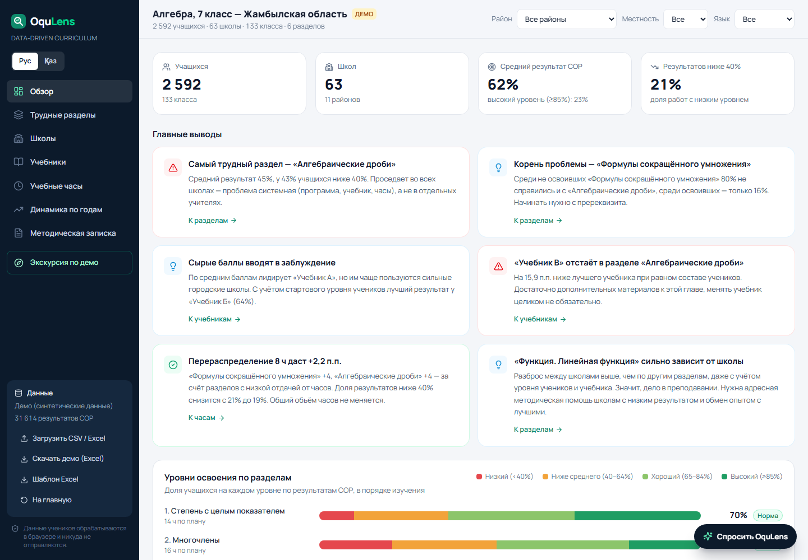
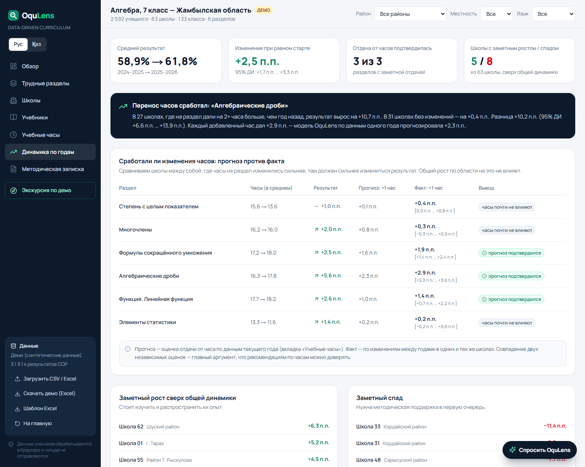
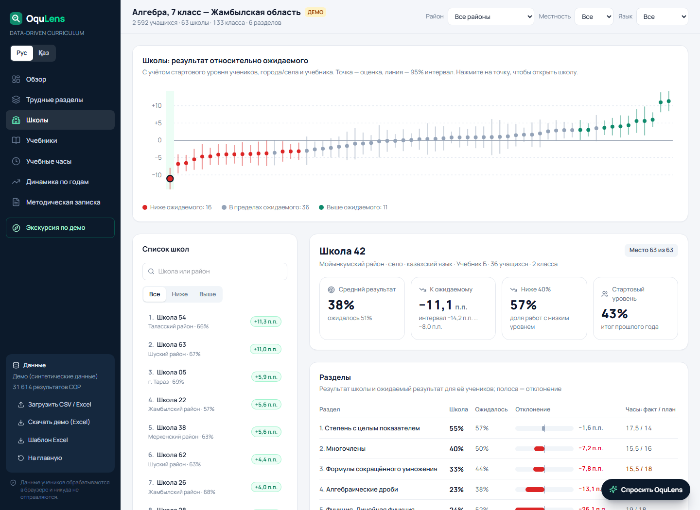
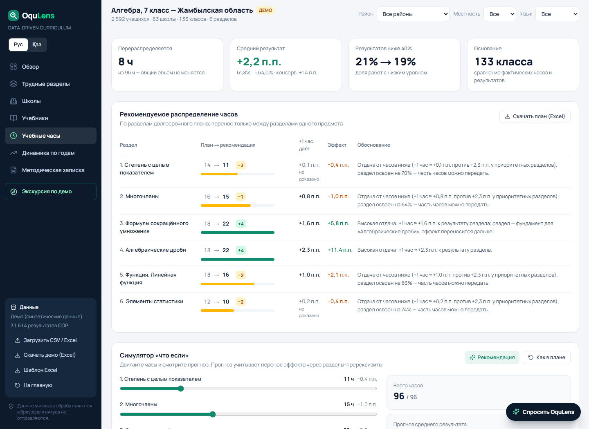
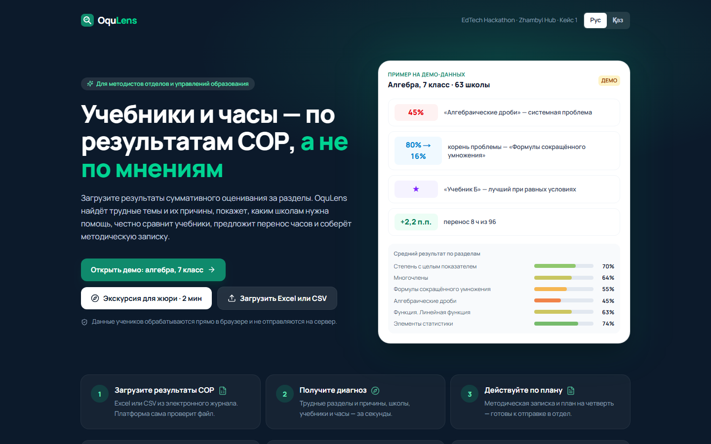

# OquLens — Data-Driven Curriculum

[](https://github.com/ikooq/oqulens/actions/workflows/ci.yml)
[](https://oqulens.vercel.app/?tour=1)

**EdTech Hackathon by Zhambyl Hub · Кейс 1: интеллектуальная система оценки эффективности учебников и учебных программ.**

OquLens — веб-платформа для методистов отделов и управлений образования. Методист загружает результаты суммативного оценивания за разделы (СОР). Платформа находит трудные разделы и их первопричину, честно сравнивает учебники и предлагает, как перераспределить учебные часы. В конце она собирает методическую записку.

> Главная ценность: решения об учебниках и часах принимаются по измеримым результатам учеников, а не по мнениям.

**Попробовать:** [oqulens.vercel.app](https://oqulens.vercel.app) · [экскурсия для жюри за 2 минуты](https://oqulens.vercel.app/?tour=1) · [на казахском](https://oqulens.vercel.app/?tour=1&lang=kk)



| Динамика: сработал ли перенос часов | Школы относительно ожидаемого |
|---|---|
|  |  |
| **План часов и симулятор «что если»** | **Стартовая страница** |
|  |  |

## Что умеет

| Задача кейса | Как решает OquLens |
|---|---|
| Анализ результатов по темам программы | Средний % и уровни освоения по каждому разделу с 95% доверительным интервалом; тепловая карта «раздел × район / школа»; фильтры по району, типу местности и языку обучения |
| Выявление трудных разделов | Диагноз разделяет **системную проблему** (раздел проседает во всех школах: программа, учебник, часы) и **зависимость от школы** (дело в преподавании). **Цепочки трудностей** находят раздел-пререквизит, из-за которого не усваивается следующий |
| Адресная работа со школами | **Карточка школы**: результат по каждому разделу относительно ожидаемого для её учеников, фактические часы против плана, конкретные рекомендации и **школы-наставники**, у которых проседающий раздел получается лучше всего (в первую очередь из того же района) |
| Сравнение учебников | Сравнение **с поправкой на состав учеников**: стартовый уровень, город/село, язык обучения. Рядом показан «сырой» рейтинг и объяснено, почему он отличается. Матрица «учебник × раздел» находит **слабые главы** конкретного учебника |
| Рекомендации по часам | Оценка отдачи от каждого дополнительного часа по разделу, перераспределение часов **в рамках утверждённого объёма**, прогноз эффекта (точечный и консервативный), симулятор «что если», выгрузка плана в Excel для КТП |
| Проверка результата изменений | Вкладка **«Динамика по годам»**: если в файле два учебных года, платформа сравнивает их при равном стартовом уровне учеников и проверяет, **сработал ли перенос часов** — фактическая отдача часа сравнивается с прогнозом модели. Показывает школы с заметным ростом и спадом сверх общей динамики |
| Обоснованность | Автоматическая методическая записка (без ИИ) + ИИ-записка на русском или казахском (Claude или бесплатные Groq / Gemini), построенная только на посчитанных цифрах. На демо-данных — блок **«Проверка метода»**: платформа сверяет найденное с тем, что заложено в данные |
| ИИ-ассистент | Чат «Спросить OquLens»: готовые вопросы (трудные разделы, школы, учебники, часы, план действий, «сработали ли изменения?», доверие к выводам) отвечаются мгновенно прямо из расчётов, свободные вопросы обрабатывает ИИ (Claude или бесплатные Groq / Gemini) по сводным показателям. Ответ ведёт на нужную вкладку или карточку школы |
| Казахский и русский | Переключатель Рус/Қаз: весь интерфейс, выводы, рекомендации школам, проверка метода, отчёт о качестве данных и методическая записка. Демо-данные тоже на казахском. Импорт понимает казахские заголовки (мектеп, сынып, балл…) |
| Экскурсия для жюри | 11 шагов за 2 минуты: сама переключает вкладки и подсвечивает главное |
| Работа с реальными файлами | Загрузка **Excel (.xlsx) или CSV** с русскими или английскими заголовками, шаблон Excel, отчёт о **качестве данных**: пропуски, повторы, баллы вне диапазона, отсутствие стартового уровня или часов |

## Как это работает (методология)

- **Единица данных** — результат одного ученика за один СОР (балл / максимум). Это стандартная форма оценивания в школах Казахстана, и она уже разбита по разделам программы.
- **Сравнение учебников.** Учебник выбирает школа, а не случай: если сильные городские школы чаще берут учебник А, его средний балл будет выше независимо от качества. Поэтому мы оцениваем линейную модель «результат ~ учебник + стартовый уровень + город/село + язык обучения» с ошибками, кластеризованными по школам, и сравниваем учебники при одинаковом профиле учеников. Слабая глава — раздел, где учебник отстаёт от лучшего заметно сильнее, чем обычно (≥ 6 п.п. сверх медианы, значимо на уровне 95%).
- **Диагноз раздела.** Внутриклассовая корреляция (ICC) по школам считается на остатках после учёта стартового уровня, типа местности и учебника. Высокий ICC означает, что результат зависит от школы, то есть от преподавания.
- **Школы.** Для каждой школы и раздела считается среднее отклонение учеников от ожидаемого (остатки той же модели: стартовый уровень, местность, учебник). У небольших школ случайный разброс велик, поэтому отклонение осторожно сдвигается к нулю пропорционально надёжности (эмпирический Байес). Школа отмечается как «ниже» или «выше ожидаемого», только если отклонение ≥ 5 п.п. (по разделу) или ≥ 3 п.п. (в целом) и интервал не пересекает ноль. Наставники подбираются среди школ, где этот раздел выше ожидаемого: сначала тот же район, затем тот же учебник.
- **Цепочки трудностей.** Для каждого раздела ищется ранее изученный раздел с наибольшей частной корреляцией (контроль: стартовый уровень и средний результат по остальным разделам). Показывается, как часто проваливают раздел те, кто не освоил пререквизит, и те, кто освоил.
- **Часы.** В разных классах на один раздел фактически тратят разное число часов. На уровне классов оценивается отдача от часов (логарифм отношения факт/план, убывающая отдача) при контроле стартового уровня, учебника и местности. Часы переносятся по одному, только если выигрыш больше потерь **в пессимистичном сценарии** (оценка ± стандартная ошибка). Эффект через пререквизиты учитывается. Ограничения: разделы со средним < 55% часы не отдают; если влияние часов доказано, раздел сокращается не более чем на 10%, иначе — не более чем на 20%; увеличение — до +30%.
- **Динамика по годам.** Ученики в разных годах разные, поэтому результаты выравниваются по стартовому уровню (модель «балл ~ стартовый уровень + год + раздел», ошибки кластеризованы по школам). Эффект часов проверяется по школам: изменение результата школы в разделе против изменения часов на этот раздел (регрессия по школам, 95% интервал). Общий рост по области на эту оценку не влияет. Дополнительно школы, добавившие ≥ 2 ч, сравниваются со школами без изменений (разность разностей). Фактическая отдача часа сверяется с прогнозом, сделанным по данным одного года.
- **Приватность.** Все расчёты выполняются в браузере. В ИИ уходят только агрегированные показатели по разделам, учебникам и школам — без данных учеников.

## Демо-данные

Кнопка «Открыть демо» генерирует **синтетический** набор данных: алгебра, 7 класс, 11 районов Жамбылской области, 63 школы, 133 класса, около 2 600 учащихся, 6 разделов, 3 условных учебника («А», «Б», «В»). Названия школ условные («Школа 01»…). Данные не описывают реальные школы или реальные учебники.

В генератор специально заложены закономерности. Платформа находит их сама, не зная о них заранее:

1. «Учебник Б» на самом деле лучше, но им чаще пользуются сельские школы → по сырым баллам он последний, с поправкой — первый.
2. В «Учебнике В» слабая глава «Алгебраические дроби».
3. «Алгебраические дроби» зависят от «Формул сокращённого умножения».
4. Отдача от часов высокая у «ФСУ» и «Дробей», низкая у «Степени» и «Статистики».
5. «Функция. Линейная функция» сильно зависит от школы (качество преподавания).
6. «Алгебраические дроби» — самый трудный раздел.
7. У каждой школы есть свой «вклад» в результат; оценка платформы совпадает с истинным вкладом с корреляцией r ≈ 0,85.
8. Данные за **два учебных года** (2024–2025 и 2025–2026). В прошлом году школы г. Тараз и Шуского района (пилот) давали «ФСУ» и «Алгебраическим дробям» на 2–3 часа меньше плана, а в 2025–2026 перешли на план. Кроме того, весь регион немного вырос. Платформа должна отделить общий рост от эффекта часов и подтвердить прогноз: например, по «Алгебраическим дробям» факт +2,9 п.п. за час при прогнозе +2,3 п.п.

Основной анализ (вкладки «Обзор»—«Учебные часы») идёт по последнему году; данные 2025–2026 совпадают с прежней версией демо. Сверка показывается прямо в приложении (блок «Проверка метода» на вкладке «Обзор»): 8 из 8. Автотесты прогоняют её на трёх разных seed.

## Формат данных (Excel или CSV)

Одна строка — результат одного ученика за один СОР. Excel (.xlsx, первый лист) или CSV (разделитель `,` или `;`, UTF-8). Заголовки можно писать по-русски или по-английски.

| Столбец | Рус. | Обяз. | Описание |
|---|---|---|---|
| `district` | район | | Район / город |
| `school` | школа | ✓ | Название или код школы |
| `locality` | местность | | город / село |
| `language` | язык | | каз / рус |
| `class_id` | класс | ✓ | Уникальный код класса |
| `student_id` | ученик | ✓ | Обезличенный ID ученика |
| `textbook` | учебник | ✓ | Учебник класса |
| `section` | раздел | ✓ | Раздел учебной программы |
| `section_order` | номер_раздела | | Порядковый номер раздела |
| `planned_hours` | часы_план | | Часы по долгосрочному плану |
| `actual_hours` | часы_факт | | Фактически проведено часов |
| `score` | балл | ✓ | Балл за СОР |
| `max_score` | макс_балл | ✓ | Максимальный балл СОР |
| `baseline_pct` | стартовый_уровень | | Итог прошлого года, % |
| `period` | учебный_год | | Учебный год, например 2025–2026. Если лет несколько, основной анализ — по последнему, а вкладка «Динамика» сравнивает два последних |

**Или «как в журнале»** — так выглядят выгрузки электронных журналов и сводные таблицы учителей: строки — ученики, столбцы — СОР.

| ФИО | СОР 1. Степень (макс 15) | СОР 2. Многочлены (макс 18) | … |
|---|---|---|---|
| Ахметов А. | 12 | 14 | |

- Максимальный балл берётся из заголовка («(макс 15)», «/ 15», «из 15») или из строки «макс».
- **ФИО сразу заменяются обезличенными кодами в браузере**. Один и тот же ученик в разных файлах получает один и тот же код, а однофамильцы из разных классов не склеиваются.
- Если нет столбцов «школа»/«класс», берётся имя файла: «Школа 12 7А.xlsx».
- Можно выбрать или **перетащить сразу несколько файлов** (по классу или по школе в каждом) — они объединятся. Отметка «н» (не писал) пропускается.
- Пример: [журнал двух школ](public/demo/oqulens_journal_example.xlsx).

Готовые примеры: [Excel](public/demo/oqulens_demo_algebra7_zhambyl.xlsx) и [CSV](public/demo/oqulens_demo_algebra7_zhambyl.csv). Шаблон Excel с описанием столбцов скачивается в приложении. После загрузки платформа показывает отчёт о качестве данных.

## Запуск

```bash
npm install
npm run dev          # http://localhost:3000
npm test             # автотесты (40): статистика, метод, импорт, журнал, динамика, ИИ-модуль, защита
npm run typecheck    # проверка типов
npm run check        # подробный отчёт аналитики на демо-данных
npm run dynamics     # отчёт по динамике год к году на демо-данных
npm run demo-csv     # выгрузка демо-файлов (CSV и Excel) и проверка импорта
```

ИИ-записка и свободные вопросы ассистенту включаются одним ключом (см. `.env.example`):

- **бесплатно, без карты** — `GROQ_API_KEY`: ключ Groq из [console.groq.com/keys](https://console.groq.com/keys). Модель `openai/gpt-oss-120b`, при исчерпании лимита — `qwen/qwen3.8-27b` и `openai/gpt-oss-20b`. Бесплатным моделям уходит сжатая сводка (без повторов), чтобы уложиться в лимит 8 000 токенов в минуту;
- **бесплатно** — `GEMINI_API_KEY`: ключ Google Gemini из [aistudio.google.com/apikey](https://aistudio.google.com/apikey). Модель `gemini-3.8-flash`, при исчерпании бесплатного лимита — запасная `gemini-3.5-flash-lite`. На бесплатном тарифе Google может использовать запросы для улучшения своих моделей — поэтому в ИИ уходят только сводные показатели, без данных учеников;
- **платно** — `ANTHROPIC_API_KEY` (Claude). Если заданы оба ключа, используется Claude (порядок: Claude → Groq → Gemini); выбрать явно можно переменной `AI_PROVIDER=groq`.

Без ключа платформа полностью работает: записка собирается автоматически из расчётов, а на готовые вопросы ассистент отвечает без ИИ.

**Прямые ссылки на демо** (удобно для жюри и QR-кода):

| Ссылка | Что откроется |
|---|---|
| `/?demo=1` | Демо на вкладке «Обзор» |
| `/?tour=1` | Демо с экскурсией для жюри |
| `/?demo=1&tab=schools&school=42` | Карточка конкретной школы |
| `/?demo=1&ask=schools` | Ассистент с ответом «Каким школам нужна помощь?» |
| `/?demo=1&tab=dynamics` | Динамика по годам: сработал ли перенос часов |
| `&lang=kk` | Всё то же на казахском |

Вкладки: `overview`, `sections`, `schools`, `textbooks`, `hours`, `dynamics`, `report`. Вопросы ассистента: `hardest`, `schools`, `textbook`, `hours`, `first`, `dynamics`, `trust`.

**Деплой:** Vercel (Next.js) из ветки `main`; ключи ИИ (`GROQ_API_KEY` и др.) — в переменных окружения проекта.

## Стек

Next.js 15 (App Router) · React 19 · TypeScript · Tailwind CSS 4 · собственная статистическая библиотека без зависимостей (МНК, кластерно-устойчивые ошибки, ICC, эмпирический Байес) · PapaParse · read-excel-file + fflate (Excel) · ИИ: Claude API (`claude-opus-5-5`) или бесплатные Groq (`gpt-oss-120b`) и Gemini (`gemini-3.8-flash`) · тесты: `node:test` + tsx · CI: GitHub Actions.

## Архитектура и безопасность данных

```
Браузер методиста                                        Сервер (Vercel)
┌──────────────────────────────────────────────┐        ┌─────────────────────────┐
│ Excel / CSV ──► импорт и проверка качества   │        │ /api/ask, /api/report   │
│                  │                           │ сводка │  ключ ИИ только здесь   │
│                  ▼                           │ (JSON, │        │                │
│ аналитика: разделы, школы, учебники, часы,   ├───────►│        ▼                │
│ динамика — всё считается здесь               │ только │ Claude / Groq / Gemini  │
│                  │                           │ агре-  └─────────────────────────┘
│                  ▼                           │ гаты)
│ вкладки, записка, Excel-выгрузки, ассистент  │
└──────────────────────────────────────────────┘
```

- **Данные учеников не покидают браузер.** Файл читается и анализируется на устройстве методиста. На сервер ничего не загружается и не сохраняется; базы данных нет.
- **В ИИ уходит только сводка**: проценты и интервалы по разделам, учебникам, школам и годам. В ней нет ID учеников, ФИО и отдельных баллов. Это проверяет автотест.
- **ИИ необязателен.** Без ключа работают все расчёты, автоматическая записка и готовые ответы ассистента. ИИ отвечает только по переданной сводке, и в инструкции ему запрещено придумывать цифры.
- **Защита ИИ-эндпоинтов.** Лимит: 10 вопросов в минуту и 150 в сутки с одного адреса, ИИ-записка — 3 в минуту. Общий предохранитель на сервер бережёт бесплатную квоту. Запросы с чужих сайтов отклоняются (проверка Origin).
- **Заголовки безопасности:** запрет встраивания на чужие сайты, `nosniff`, строгий Referrer-Policy, HSTS, отключены камера, микрофон и геолокация.
- **Ключи ИИ** хранятся только в переменных окружения сервера и в браузер не передаются. Текст ошибок провайдера очищается от всего, похожего на ключ.
- **Обезличивание на входе.** Шаблон просит обезличенный ID ученика вместо ФИО. Школы оцениваются относительно ожидаемого для их учеников, чтобы организовать поддержку, а не составить рейтинг.
- **Качество кода.** Аналитика покрыта автотестами: статистика проверяется на данных с известным ответом, метод — на трёх наборах демо-данных. GitHub Actions на каждый push запускает тесты, сборку и проверку типов.

## Структура

```
src/lib/analytics.ts   аналитическое ядро: разделы, пререквизиты, школы, учебники, часы, выводы
src/lib/dynamics.ts    динамика год к году: сработали ли изменения часов
src/lib/schools.ts     рекомендации для карточки школы
src/lib/validation.ts  проверка метода на демо-данных
src/lib/stats.ts       МНК, кластерные ошибки, ICC, ГСЧ
src/lib/generator.ts   генератор синтетических демо-данных (с «истинными» закономерностями)
src/lib/csv.ts         импорт CSV, проверка качества данных, объединение файлов
src/lib/journal.ts     импорт «как в журнале»: ученики × СОР, ФИО → коды
src/lib/rateLimit.ts   лимиты запросов к ИИ, проверка Origin
src/lib/xlsx.ts        импорт Excel
src/lib/xlsxWriter.ts  выгрузка Excel (шаблон, план часов)
src/lib/report.ts      сводка анализа для ИИ (только агрегаты)
src/lib/memo.ts        автоматическая методическая записка (RU/KZ)
src/lib/answers.ts     готовые ответы ассистента из расчётов
src/lib/i18n.ts        двуязычный интерфейс (русский / казахский)
src/lib/llm.ts         ИИ-провайдеры: Claude, бесплатные Groq и Gemini
src/app/api/report     ИИ-записка
src/app/api/ask        ИИ-ассистент: свободные вопросы
src/components/        интерфейс: обзор, разделы, школы, учебники, часы, динамика, записка, ассистент, экскурсия
tests/                 автотесты (node:test): статистика, метод, импорт, динамика, ИИ-модуль
.github/workflows/     CI: тесты, сборка, проверка типов
```

## Ограничения и развитие

- Учебники выбираются не случайно; поправка учитывает наблюдаемые различия, но не все. Для выводов о смене учебника рекомендуется пилот.
- Эффект часов оценён по естественным различиям между классами. Вкладка «Динамика» позволяет проверить прогноз на следующем учебном году; надёжнее всего — пилот в 5–10 школах.
- Оценка школ относительно ожидаемого — инструмент адресной поддержки и обмена опытом, а не рейтинг для взысканий.
- Казахский перевод интерфейса сделан командой; перед внедрением его стоит вычитать носителю языка из методической службы.
- Дальше: прямая интеграция с электронными журналами по API, анализ на уровне целей обучения и отдельных заданий СОР (типичные ошибки), данные МОДО, динамика по четвертям внутри года.
